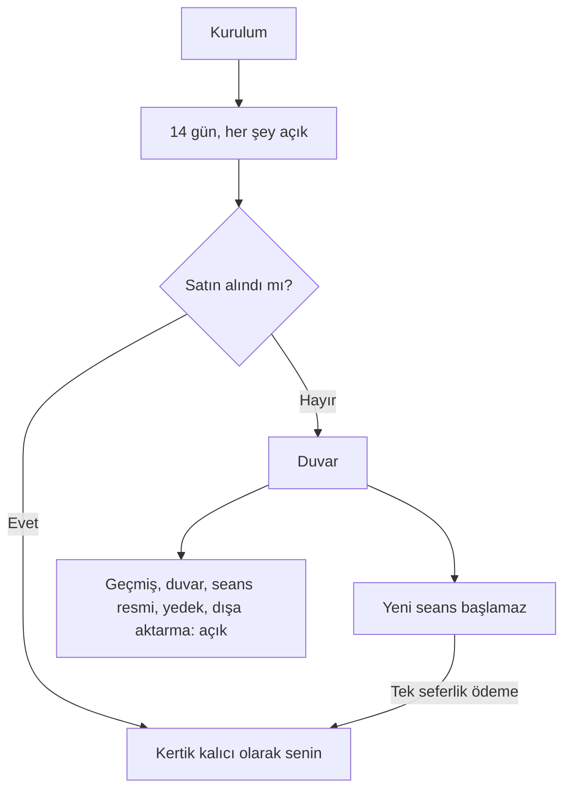

# Fiyat ve Pazar Kararı (4 Eylül 2026)

Bu dosya 16-para-kazanma.md'nin devamıdır ve onun fiyat bölümünü günceller. Model kararı orada verilmişti, burada hedef kitle, fiyat seviyesi ve kilidin nereye konacağı netleşiyor.

> **4 Eylül akşamı revize edildi.** İlk hâlinde freemium vardı: çekirdek sonsuza kadar ücretsiz, dört ek yüzey kilitli. O paket zayıftı; kimse bildiriminde canlı sayaç görmek için 6 dolar vermez. Yerine **deneme, sonra duvar** geldi. Bölüm 3 baştan yazıldı, bölüm 5 güncellendi. Kodda uygulanmış hâli `37-kertik-tam-kod.md`.

## Karar özeti

| Konu | Karar |
| --- | --- |
| Mağaza modeli | Ücretsiz indirme, uygulama içi tek seferlik "Kertik Tam" |
| Deneme | 14 gün tam erişim, sonra yeni seans başlamaz; kayıt açık kalır |
| Kalıcı ücretsiz katman | Yok. Kısıtlı sürüm diye bir şey yok |
| Açılış fiyatı | 9,99 $ küresel, 149,99 TL Türkiye |
| İkinci aşama fiyatı | 12,99 $, sosyal kanıt birikince (aşağıda) |
| Abonelik | Yok |
| Gelir pazarları | ABD, Kanada, İngiltere, Avustralya, Almanya, Japonya, Güney Kore |
| Hacim ve ilk yorum pazarı | Türkiye, Brezilya, Hindistan |

## 1. Hedef kitle

İki ayrı kitle var ve karıştırılmaları pahalıya mal olur.

**Hacim kitlesi: sınav çalışan öğrenci.** Türkiye Google Play indirmelerinde ilk ondadır, 2025'te 3,1 milyar indirme ile sekizinci sıradadır, ama aynı listede aktif kullanıcı tarafı sert biçimde gerilemiştir. Hindistan 26,2 milyar, Brezilya 10 milyar indirmeyle listenin başındadır. Bu ülkeler indirme üretir, gelir üretmez.

**Gelir kitlesi: çalışan yetişkin.** Google Play uygulama içi harcamasında ABD yaklaşık 52 milyar dolarla açık ara birincidir, Japonya yaklaşık 16 milyar dolarla üçüncüdür ve kullanıcı başına harcamada birçok pazarın üzerindedir. Almanya ve Güney Kore aynı kümededir. Bu ülkelerde ödeme alışkanlığı oturmuştur ve tek seferlik satın alma yadırganmaz.

Kertik'in ürün özellikleri bu ikinci kitleye daha yakındır. Rahatsız Etmeyin entegrasyonu, dürüst kayıt ve düzeltilebilir seans, sorumluluğu kendinde olan bir yetişkinin araçlarıdır; öğrenci sayaç kültürü ise sıralama, arkadaş listesi ve çalışma odası gibi sosyal özellikler etrafında döner ve Kertik'te bunlar bilinçli olarak yoktur.

Pratik sonuç: mağaza metninin İngilizce sürümü birinci öncelik, Türkçe sürümü ikinci öncelik olmalı. Türkçe pazar ilk yorumları ve ilk yüz kullanıcıyı ucuza getirir, geliri getirmez. Japonca ve Almanca metinler ikinci dalga işidir, çünkü Japonya'da yerelleştirme doğrudan satın almayı etkiler.

## 2. Rakip fiyat bandı

| Uygulama | Model | Fiyat |
| --- | --- | --- |
| Forest | iOS tek seferlik | 3,99 $ |
| Forest | Android ücretsiz, Pro yükseltme | 1,99 $, ayrıca Forest Plus aboneliği |
| Focus To-Do | Ücretsiz katman, ömür boyu | 11,99 $ |
| Session | Abonelik | 4,99 $/ay, 39,99 $/yıl |
| Flow | Abonelik veya ömür boyu | 2,99 $/ay, 17,99 $/yıl, 39,99 $ ömür boyu |
| Be Focused Pro | Tek seferlik | 1,99 $ |

Tek seferlik ödemeler 1,99 ile 11,99 arasında toplanıyor. 9,99 bandın üst ucudur, 39,99 ise ancak masaüstü ve senkron vaadiyle savunuluyor.

## 3. Kilit nereye konacak

İlk kurgu freemium'du: çekirdek sonsuza kadar ücretsiz, üstüne dört yüzey kilitli. İki yerden birden çöktü.

Birincisi paket. "Widget, Rahatsız Etmeyin, bildirimdeki canlı sayaç, kart paylaşımı" bir ürün değil, bir artık listesi. Bunlar için ödeme yapılmaz.

İkincisi ve daha kötüsü: o kurguda **widget kilitliydi**. Widget, Kertik'in başkasının görebileceği tek yüzeyi. Telefondaki bir uygulamayı kimse görmez, ana ekrandaki bir widget'ı görür. Yani model, itibar üretecek tek organı kullanıcıların çoğundan saklıyordu. Duvar modelinde her etkin kullanıcı ödeyen kullanıcıdır ve hepsinin ana ekranında widget durur.

Karar: **14 gün her şey açık, sonra duvar.** Kısıtlı sürüm yok, ikinci sınıf kullanıcı yok. Kertik tek bir nesne olarak kalıyor, temel model artı opsiyon paketi olmuyor.

### Ayakta kalan ilke

16-para-kazanma.md'deki "çekirdek sonsuza kadar ücretsiz" cümlesi bu kararla ölüyor. Altındaki asıl ilke yaşıyor ve daha net hâle geliyor: **kullanıcının kendi kaydı asla rehin alınmaz.**

Uygulanan sınır tam olarak şu: duvardan sonra kilitlenen **alet**, kayıt değil. Kullanıcı geçmişini görür, duvarını görür, seans resimlerini açar, yedeğini alır, verisini dışa aktarır. Yapamadığı tek şey yeni seans başlatmak. Süren bir seans varsa bitene kadar dokunulmaz; kimsenin işi ortasından kesilmez.

### Satışı yapan şey

On dördüncü günde kullanıcıya özellik listesi gösterilmiyor. **Kendi kaydı** gösteriliyor: kaç seans, kaç saat. Soru "widget ister misin" değil, "bunu tutmak istiyor musun". Satışı yapan şey uygulamanın sanatı oluyor, bir madde listesi değil. Deneme süresinin 14 günde kalmasının sebebi de bu: 7 günde ortada tutmaya değer bir duvar birikmiyor.

### Kilit tablosu

| Katman | İçerik |
| --- | --- |
| Duvardan sonra da açık | Geçmiş, duvar, kadran, seans resimleri, görevler, yerel yedek, Drive senkronu, dışa aktarma, tema, 15 dil |
| Kertik Tam gerektiren | Yeni seans başlatmak, yani uygulamanın kendisi |

Reklam hiçbir yerde yok.

### Kabul edilen bedel

Bu yapı erişimi feda ediyor. Ücretsiz katman olmayınca organik yayılma büyük ölçüde durur; uygulama az kurulumla sessizce ölebilir. Buna bilerek razı olunuyor: burada ölçek oyunu değil, beğeni nesnesi oyunu oynanıyor.

Bunun tek zorunlu karşılığı dürüstlüktür. Mağaza metninin en üstünde, büyük ve net: **14 gün deneme, sonra tek seferlik satın alma.** Bu saklanırsa gelen ilk tek yıldızın adı "para istiyor" olur ve haklı olur.

## 4. Fiyat: 9,99 ile açıyoruz

Bu rakam bir kez 5,99'a çekilmişti. Gerekçesi şuydu: uygulama içi ürünün fiyatı sonradan yükseltilebilir, açılış penceresi ise tekrarlanamaz; o yüzden düşük açılış geri alınabilir bir karar, yüksek açılış geri alınamaz bir kayıptır.

O muhakeme freemium içindi ve orada doğruydu. Duvar modelinde geçersiz, çünkü satılan şey değişti. Freemium'da 5,99 dört yüzeylik bir yükseltme paketinin fiyatıydı; duvarda uygulamanın kendisinin fiyatı.

Kararı veren asıl şey ödeme anının nereye taşındığı oldu. Mağaza sayfasında fiyat, yanındaki "ücretsiz" rakamıyla kıyaslanan bir sürtünme sayısıdır. Duvarda öyle bir an yok: ödeme ekranını gören kişi uygulamayı on dört gün kullanmış ve ekranda kendi kaydını görüyor. Fiyat duyarlılığının en düşük olduğu an budur ve 5,99 ile 9,99 arasındaki fark burada dönüşümü belirleyici biçimde değiştirmez.

İkinci gerekçe aritmetik. Bu modelde keşif zaten büyük ölçüde ölüyor (bölüm 3, kabul edilen bedel). Erişimin daralttığı bir yapıda önemli olan dönüşüm oranı değil, dönüşen kullanıcı başına gelirdir. Aynı sayıda alıcıda 9,99, 5,99'un yüzde 67 üstüdür.

**Neden 12,99 değil.** Tek seferlik odak uygulaması bandının tepesi 11,99 civarı (Focus To-Do ömür boyu). Sıfır yorumla, sıfır basınla bandın tepesini aşan bir uygulama "premium" değil, "pahalı ve tanınmayan" okunur. 9,99 tanınmayan bir uygulamanın savunabileceği en yüksek nokta ve yuvarlak, kendinden emin bir rakam.

**12,99'a çıkmanın şartı** sosyal kanıttır, ikisi birden:

1. En az 200 yorum ve 4,5 üstü ortalama
2. İkinci bir yüzey, iOS ya da masaüstü

Fiyat yükseltmek serbest, indirmek değil. İndirim yapılmayacak: indirim bekleyen kullanıcıyı ödüllendirir ve tam fiyatı bir daha savunamazsın.

### Türkiye fiyatı

Play'in otomatik çevirisi bırakılırsa 9,99 $ bugünkü kurla (1 $ ≈ 48,3 TL) yaklaşık 480 TL'ye oturur. Bu Türkiye'de bir odak uygulaması için satış öldürücüdür ve küresel fiyat yükseldiği için makas daha da açıldı.

**149,99 TL** doğru nokta. Hesap şöyle işliyor:

| Kalem | Türkiye 149,99 TL | Küresel 9,99 $ |
| --- | --- | --- |
| Kullanıcının ödediği | 149,99 TL | 9,99 $ |
| KDV sonrası (%20) | 124,99 TL | vergi ülkeye göre üstüne eklenir |
| Google hizmet ücreti sonrası (%15) | ≈ 106 TL | ≈ 8,49 $ |
| Yaklaşık dolar karşılığı | ≈ 2,20 $ | 8,49 $ |

Türkiye küresel fiyatın yaklaşık dörtte birine geliyor. Bu bilinçli: duvar modelinde ödemeyecek kullanıcı zaten çıkıyor, Türkiye fiyatı ödeyecek azınlık için ayarlanıyor ve 150'nin altında kalması gerekiyor.

Küçük İşletme Programı'na kaydolmak şart, komisyon %30 yerine %15 oluyor ve yukarıdaki hesap buna dayanıyor.

Diğer ülkeler için tek tek uğraşmaya gerek yok, Play'in satın alma gücüne göre bölgesel fiyatlandırmasını açmak Brezilya, Hindistan, Polonya ve Arapça pazarlarda aynı işi görür. Elle ayarlanacak tek ülke Türkiye'dir.

## 5. Sıradaki işler

Kod tarafı bitti (4 Eylül, ayrıntısı `37-kertik-tam-kod.md`):

- [x] Play Billing 9.1.0 `build.gradle.kts` içine eklendi
- [x] `Kasa.kt`: satın alma akışı, `queryPurchases` ile geri yükleme, onaylama, WebView köprüsü
- [x] `MainActivity.kt` köprü kaydı, `onResume` tazelemesi
- [x] `index.html`: deneme sayacı, duvar, satın alma yüzeyi, 20 anahtar × 15 dil
- [x] Simülatör yeniden üretildi, mevcut test paketinde yeni kırmızı yok

Play Console tarafı, sırayla:

1. Uygulamayı ücretsize çevir. **Bu geri dönüşü olmayan adımdır**, aynı paket adıyla bir daha ücretli listelemeye dönülemez.
2. `kertik_tam` kimliğiyle tek seferlik ürün oluştur: **9,99 $ küresel, 149,99 TL Türkiye**. Diğer ülkeler için Play'in satın alma gücüne göre bölgesel fiyatlandırmasını aç, elle ayarlanacak tek ülke Türkiye.
3. Küçük İşletme Programı'na kaydol, komisyon %30 yerine %15.
4. Mağaza listelemesini bölüm 7'deki metinlerle doldur.
5. Lisans test hesaplarını gir, satın almayı ücretsiz dene.
6. Kapalı testte ücretliyken alan arkadaşlara tanıtım kodu ver; Play onları `kertik_tam` sahibi saymıyor.
7. Kapalı testi yeniden başlat.

## 6. Ne ölçeceğiz

Fiyat kararını yorumla değil sayıyla güncellemek için dört sayı yeter: kurulumdan ilk seansa geçen oran, 14. güne ulaşan kullanıcı oranı, kilit ekranını görenlerin satın alma oranı, ve ülke bazında kullanıcı başına gelir. Dördüncüsü hangi dile yatırım yapılacağını da söyler.

## Kaynaklar

- [App Downloads by Country 2025, FoxData](https://foxdata.com/en/blogs/app-downloads-by-country-2025-top-markets-on-app-store-google-play/)
- [Google Play revenue by country, OneSky](https://www.onesky.ai/blog/japan-overtook-us-to-become-the-top-country-for-google-play-revenue)
- [Pomodoro Apps Compared 2026](https://goalsandprogress.com/pomodoro-apps-comparison/)
- [Forest, Google Play listelemesi](https://play.google.com/store/apps/details?id=cc.forestapp)
- [Uygulamanızın fiyatlarını ayarlama, Play Console Yardım](https://support.google.com/googleplay/android-developer/answer/6334373?hl=tr)
- [Açık, kapalı veya dahili test oluşturma, Play Console Yardım](https://support.google.com/googleplay/android-developer/answer/9845334?hl=tr)
- [Uygulama lisanslamayla faturalandırma testi, Play Console Yardım](https://support.google.com/googleplay/android-developer/answer/6062777?hl=tr)
- [USD/TRY kuru, Wise](https://wise.com/us/currency-converter/usd-to-try-rate)

## 7. Mağaza listelemesi

Uygulama adı en çok 30, kısa açıklama 80, uzun açıklama 4000 karakter. Adı ASO'da en ağır alan, o yüzden "Kertik" tek başına bırakılmıyor: marka önde kalıyor, arkasına iki anahtar kelime ekleniyor.

| Alan | Türkçe | İngilizce |
| --- | --- | --- |
| Ad | `Kertik: Odak Kronometresi` (25) | `Kertik: Focus Stopwatch` (23) |
| Kısa açıklama | `Sessiz bir kronometre; çalıştıkça bir sanat birikir. 14 gün deneme, tek ödeme.` (78) | `A quiet stopwatch that turns your focus into art. 14 days free, then buy once.` (78) |

Kısa açıklama hem vaadi hem ticari şartı taşıyor. Deneme ve tek ödeme bilgisinin **kısa açıklamada** olması pazarlık konusu değil: bu saklanırsa gelen ilk tek yıldızın adı "para istiyor" olur ve haklı olur. Duvar modelinin bedeli budur, peşin ödenir.

Uzun açıklamanın ilk iki satırı listeleme sayfasında katlanmadan görünen tek yerdir; oraya da aynı iki cümle, aynı sırayla girer.

### Uygulama içi ürünün alanları

Ürün kimliği `kertik_tam`, bir kez oluşturulduktan sonra değiştirilemiyor. Varsayılan
dil en-US, gerisi "Çevirileri yönet" altından giriliyor. Ad en çok 55, açıklama en çok
200 karakter.

| Dil | Ad | Açıklama |
| --- | --- | --- |
| en-US | Kertik Tam — full access | Unlocks Kertik for good. Keep starting sessions after the 14-day trial ends. One payment, no subscription, no ads. Your records, history and backup are free either way. |
| tr | Kertik Tam | Kertik'i kalıcı olarak açar. 14 günlük deneme bittikten sonra seans başlatmayı sürdürürsün. Tek ödeme, abonelik yok, reklam yok. Kayıtların ve yedeğin zaten hep ücretsiz. |
| de | Kertik Tam — voller Zugriff | Schaltet Kertik dauerhaft frei. Starte auch nach den 14 Testtagen weiter Sitzungen. Einmalzahlung, kein Abo, keine Werbung. Aufzeichnungen und Sicherung bleiben ohnehin kostenlos. |
| ja | Kertik Tam（フルアクセス） | Kertik を永続的に開放します。14日間のお試し後もセッションを始められます。一度きりの支払い、サブスクなし、広告なし。記録とバックアップはもともと無料です。 |
| ko | Kertik Tam — 전체 이용 | Kertik을 영구적으로 열어 줍니다. 14일 체험이 끝난 뒤에도 세션을 시작할 수 있어요. 한 번만 결제하고 구독도 광고도 없습니다. 기록과 백업은 원래 무료입니다. |
| zh-Hans | Kertik Tam — 完整版 | 永久解锁 Kertik。14 天试用结束后仍可开始新的专注。一次付费，没有订阅，没有广告。你的记录和备份本来就免费。 |
| zh-Hant | Kertik Tam — 完整版 | 永久解鎖 Kertik。14 天試用結束後仍可開始新的專注。一次付費，沒有訂閱，沒有廣告。你的記錄與備份本來就免費。 |
| es | Kertik Tam — acceso completo | Desbloquea Kertik para siempre. Sigue empezando sesiones cuando terminen los 14 días de prueba. Un solo pago, sin suscripción ni anuncios. Tus registros y tu copia ya son gratis. |
| fr | Kertik Tam — accès complet | Débloque Kertik définitivement. Continue à lancer des séances après les 14 jours d'essai. Un seul paiement, sans abonnement ni publicité. Tes historiques restent gratuits. |
| pt-BR | Kertik Tam — acesso completo | Libera o Kertik para sempre. Continue começando sessões depois dos 14 dias de teste. Pagamento único, sem assinatura e sem anúncios. Seus registros já são gratuitos. |
| it | Kertik Tam — accesso completo | Sblocca Kertik per sempre. Continua ad avviare sessioni dopo i 14 giorni di prova. Pagamento unico, nessun abbonamento, nessuna pubblicità. I tuoi dati restano gratuiti. |
| ru | Kertik Tam — полный доступ | Открывает Kertik навсегда. Начинай сессии и после 14 дней пробного периода. Одна оплата, без подписки и рекламы. Записи и резервная копия и так бесплатны. |
| nl | Kertik Tam — volledige toegang | Ontgrendelt Kertik voorgoed. Blijf sessies starten na de proefperiode van 14 dagen. Eenmalige betaling, geen abonnement, geen advertenties. Je gegevens blijven gratis. |
| pl | Kertik Tam — pełny dostęp | Odblokowuje Kertik na stałe. Zaczynaj sesje także po 14 dniach okresu próbnego. Jedna płatność, bez abonamentu i reklam. Twoje zapisy i kopia i tak są darmowe. |
| ar | Kertik Tam — وصول كامل | يفتح Kertik بشكل دائم. تابع بدء الجلسات بعد انتهاء تجربة الأربعة عشر يومًا. دفعة واحدة، بلا اشتراك وبلا إعلانات. سجلّاتك ونسختك الاحتياطية مجانية أصلًا. |

Türkçe adda "tam erişim" gibi bir açıklama yok, çünkü "Tam" zaten Türkçe. Diğer
dillerde marka önde kalıp arkasına düz bir karşılık geliyor; sepette ne aldığını
anlamayan kullanıcı iade ister.

Açıklamaların hepsi aynı üç şeyi aynı sırayla söylüyor: kalıcı açılır, tek ödeme,
kayıt zaten ücretsiz. Üçüncüsü iade ve tek yıldız önleyicidir.

Kalan alanlar: **Etiketler** boş (çok ürünü gruplamak için, tek üründe işlevsiz).
**Ürün vergisi kategorisi** "Dijital uygulama satışları" olarak kalır, doğrusu bu.
**Yaş derecelendirmesi** seçilmez, ürün uygulamanınkini devralır.

Simge `tasarim/kertik-tam-simge.png`: 1024 piksel, kare, 32 bit PNG. Uygulamanın
içindeki satın alma ekranının aynı çizimi, beşinci çentik kesilmiş hâliyle. Play'in
"metin, tanıtım ya da marka koymayın" kuralına uyuyor: içinde tek bir harf yok.
