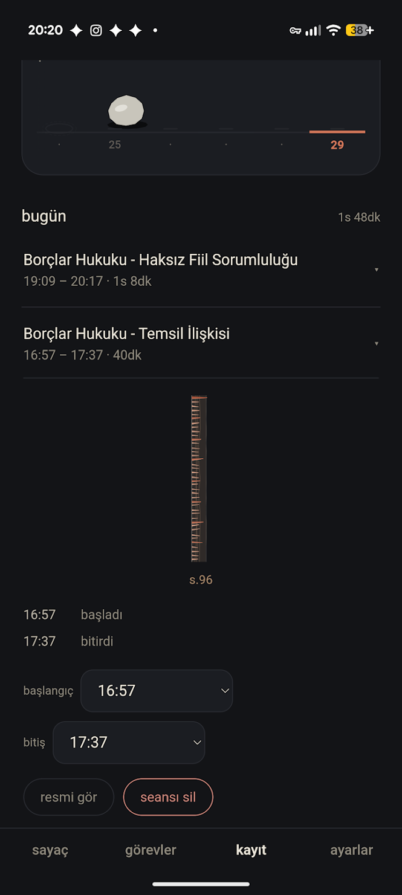

### 29 Ağustos 2026

- [x] yeni görev butona eklemek lazım seansı bitirmeden diğer görevi geçtiğini göstermek için.

  ---

  şöyle ki şu anda bu çok garip çalışıyor yani eğer günlük görevler varsa onları ekleyebiliyoruz ama insan p hâzır ki günlük görevler eklemeden seans başlatabilir bu yüzden direkt sonraki seans geçme gibi bir tuş olsun istiyorum kullanıcı eşine bitirdikten sonra ya da seansa geçerken bunları adlandırabilir bence

  
- [ ] aynı anda hem sayfa hem de soru ekleyebilirim bence yani test kitabından şu konuyu bitirdim derim aynı zamanda da şu kadar doğru yanlış falan yaptım de ekleyebilirim bence.
- [ ] takip uygulamasına da bir tane özellik yapmalıyız sonra çözümünden eğer konuyu öğreniyorsa mesela bir tik falan işaretleyebilir bence böylece takip uygulaması da buna soru çözme hızım olarak okumaz hem bu tür yaptıklarından çok daha fazla yanlışım ve boşum çıkıyor bunlar da farklı bir şekilde hesaplanabilir bu uygulama babında konuşursak da sence böyle bir buton bu uygulamaya da ekleyelim mi ne diyorsun?
- [x] gördüğün gibi ben uygulamayı böyle kullanıyorum ama her seferinde borçlar hukuku yazmam birazcık gereksiz kalıyor yani acaba zaten halihazırda çalıştığım şeylere seçerek yanına bir şey yazmak daha mantıklı olunmaz mı mesela görevlerde borçlar hukuku yazar ben yanında bunu yazarım ya da bilemedim ya belki görevlere direk burada yazdığım şeyin aynısını yazarım seans bittikten sonra seçerim tamamlandı olarak sen karar ver buna.
  

> 2 Eylül 2026 — 1. ve 4. madde `+ yeni iş` ile karşılandı (bkz. `35-seans-icinde-is-degisimi.md` §14).
> 2. madde (aynı işe hem sayfa hem soru) bilinçli olarak ertelendi.
