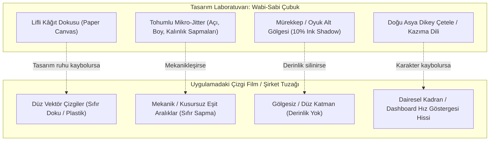

# 20 — Sanat ve Çizim Geri Bildirimleri (16 Ağustos 2026)

> Bu dosya, silinen `20-kullanim-feedback.md`'nin **korunması gereken** kısmıdır.
> O dosyanın fiyat/widget/tam ekran bölümleri `21-tam-ekran-widget-fiyat.md`'ye,
> çoklu dil bölümü `22-coklu-dil.md`'ye taşındı. Buradakiler gerçek kullanımdan
> çıkmış görsel gözlemler — hiçbir yerde kopyası yoktu.

İlgili: `19-akis-ve-cubuk.md`, `tasarim/simulator.html`,
`antigravity/ornekler/arkaplan_canlanma_demo.html`

---

## 1. Çizim aniden beliriyor ("popping")

**Gözlem:** Arka plandaki çizim, seans başlayınca veya sayfa geçişlerinde bir anda
"küt diye" var oluyor. Sanki yavaş bir bağlantıdan görsel sonradan inip ekrana
düşüyormuş gibi bir gecikme/kalitesizlik hissi veriyor.

**Beklenti:** Doğal, yumuşak, akıcı bir doğuş.

**İlk Düşünce:** Çizim `opacity 0 → 1` ile **400–600 ms** içinde açılsın; tercihen şeritler
sırayla değil, bütün olarak. Tam ekran seans moduna geçişle aynı anda yapılmalı
(bkz. `21`, bölüm 1) — iki geçiş tek hareket gibi görünsün.

**Başka bir öneri**: çizileceği zaman gerçek bir fırça gibi ilk andan son tarafa doğru bilsin küçük bir animasyon ama premium hissettirebilir. 

---

## 2. İlk açılışta hiçbir ipucu yok

**Gözlem:** Uygulamanın en güçlü görsel özelliği olan arka plan çizimi, ilk açılışta
(boş/bekleme ekranında) hiç görünmüyor. Kullanıcı ancak seans başlatırsa fark ediyor.

**Beklenti:** "Arkada böyle bir şey oluşacak" merakını seans başlamadan verebilmek.

**Karar — ama kural bozulmadan:**
`ebru-muhur.md`'deki kalıcı karar net: **sürekli çalışan animasyon/döngü YOK**
(rAF, parçacık, dalgalanma, nefes alan halka). "Küçük animasyon / hafif dalgalanma /
mikro hareket" bu kurala çarpıyor ve pil yiyor.

Aynı merakı kural bozmadan vermenin yolu:

> Ekran açılınca **dünün izinin soluk hâli** (~%25 opaklık) **1,5 saniyede çizilir
> ve durur.** Döngü yok, tek seferlik doğuş.

Bu hem "arkada bir şey oluşuyor" hissini verir, hem de "bu senin kaydın" der —
desen ödül değil, günün izi ilkesiyle uyumlu kalır.

Kayıt yoksa (ilk açılış): çok seyrek, nötr bir tohum deseni. Yine tek seferlik.

---

## 3. İki renk kısıtı ve süre okunabilirliği

**Gözlem:** Çalışmada tek renk, molada tek zıt renk. Her zaman aynı iki renk. Çiğ duruyor.

**Beklenti — iki ayrı şey, ikisi de önemli:**

1. **Süre dağılımı resimden okunabilmeli.** Kullanıcı arkadaki resme bakınca seansın
   ne kadarının molada, ne kadarının çalışmada geçtiğini sezgisel anlayabilmeli.
2. **İki çiğ renkten çıkılmalı.** Ara tonlar, geçiş renkleri, harmonik tonlar —
   akışkan mineral doku, petrol/arduvaz tonları, derin sıvı dalgalanmaları gibi
   zengin organik katmanlar.

**Not:** Madde 1 çok değerli — deseni süsten çıkarıp **kayda** dönüştürüyor.
"Dürüst kayıt" fikrinin görsel karşılığı. Öncelik bunda olsun.

**Teknik kısıt (`ebru-muhur.md`'den):** Yarı saydam şekiller üst üste binince renkler
griye düşüyor. Bu yüzden akışta her şerit tek renk, hue karıştırılmıyor. Ara tonlar
**şerit içinde karıştırılarak** değil, **şeritler arası palet genişleterek** yapılmalı —
ör. iş renginin 3 tonu, mola renginin 2 tonu, aralarında bir köprü ton.

---

## 4. Pomodoro ve kronometre çiziminin ayrışması

**Gözlem/talep:** İki mod aynı mantıkta çizmemeli.

* **Pomodoro:** bitiş süresi belli. Tohumlanmış (seeded), seans boyunca ilerleyen,
  hedefe ulaşınca tamamlanan bir yapı.
* **Kronometre:** bitiş serbest. Sabit hedefe kilitlenmeden, zaman aktıkça gelişen
  ve evrilen bir yapı.

**Uyarı — bu maddeyi olduğu gibi uygulama:**

"Tamamlanan çizim" varsa, **tamamlanmayan çizim de var** demektir. Yarım kalmış resim,
Forest'ın kuruyan ağacının yaptığı şeyi yapar: suçlar. Bu iyi bir şey mi düşünülmeli.

**Doğru ayrım:**
- Pomodoro'da desenin **ölçeği** hedefe göre kurulur (25 dakikaya sığacak kompozisyon).
- Ama **"eksik" hâli olmaz** — 12. dakikada durdurulan resim de kendi başına tam görünür.
- Kronometrede ölçek açık uçlu; yoğunluk dakikayla artar (mevcut `akis.html` davranışı).

Yani fark **kompozisyonun sınırı**, tamamlanma/tamamlanmama değil.

---

## 5. Kaldırılan madde — seans sonu "başarı kartları"

Silinen dosyada Midjourney/DALL-E promptları için bir alan vardı; kategorilerden biri
**"Seans Sonu Başarı Kartları"** idi.

**Bu madde bilinçli olarak kaldırıldı:**
- "Başarı kartı" = rozet. Bilinçli YOK listesinde.
- AI üretimi raster görsel, çentik–çizgi–kâğıt diline uymuyor (bkz. `ebru-muhur.md`:
  ebru **alan** diliyle çalıştığı için reddedildi; raster illüstrasyon da öyle).
- APK'yı şişirir.

**Yaşayabilecek hâli:** başarı kartı değil, **aylık arşiv sayfası** — `cubuk.html`'deki
çetele duvarı fikri. Ödül değil, kayıt. 

Tasarımlar içinde çubuk diye geçiyor zaten bu buna bakılabilir bir kalas gibi minimalist tik asya vari estetiği olan güzel bir duruşu var, yani şirket raporu gibi değil. Göze hoş geliyor ve bilgi veriyor.

---

## 6. Çubuk Estetiği: Asya/Wabi-Sabi Minimalizminden "Şirket İstatistiği" ve Çizgi Film Tuzağına Düşmeme

**Gözlem ve Algı Uçurumu:**
Tasarım klasöründeki (`tasarim/cubuk.html`) ilk konsept görüldüğünde uyandırdığı ilk his: *"Çok Asya-vari, Japon minimalistliği taşıyan, parşömene/ahşaba kazınmış sanatsal bir nesne"* ("wow" etkisi). 

Fakat canlı uygulamadaki (`uygulama/www/index.html`) mevcut çizgiler incelendiğinde ortaya çıkan his:
- Çizgiler **"çizgi film gibi"** (plastik, çiğ, steril vektörel).
- Dışarıdan bakan bir göz (özellikle anime ve Japon görsel kültürüne aşina biri) bunu estetik bir Doğu sanatı olarak değil, **"şirket istatistiği / sıkıcı bir bar chart / KPI panosu"** gibi algılıyor.

### Neden Tasarımda "Sanat", Canlı Uygulamada "Excel Grafiği" Gibi Duruyor? (Fark Analizi)

1. **Çubuk (Dikey Sütun) vs. Dairesel Kadran Karmaşası:**
   - `tasarim/cubuk.html` dosyasındaki çubuk; dikey akan, yukarıdan aşağıya dizilen, Doğu Asya kaligrafi omurgası (`tategaki`) taşıyan bağımsız bir ahşap/parşömen kaydıdır.
   - Canlı uygulamada (`uygulama/www/index.html`) ise ana ekranda ve özet pencerelerinde çubuk yerine standart dairesel SVG kadranı (`drawStopwatchDial`) yer alıyor. Dairesel kadran tek başına kaldığında otomobil hız göstergesi veya akıllı saat widget'ı gibi duruyor.

2. **Kusursuzluğun Yarattığı "Plastik" Etki (Wabi-Sabi Eksikliği):**
   - `cubuk.html`'de her çizginin açısı `y1 = y0 + (r3 - .5) * 1.5` ile hafif eğik, boyu `(1 + (r1 - .5) * .09)` ile mikro değişken ve kalınlığı `1.35 + (r1 - .5) * .35` ile organik basınca sahipti.
   - Uygulamada çizgiler dümdüz matematiksel açılarla ve sabit piksel kalınlığıyla basıldığında insan beyni bunu "el yapımı / kazınmış sanat" olarak değil, "şirket raporundaki eşit çubuklar" olarak kodluyor.

3. **Dokusal Zemin ve Oyuk Gölgesi:**
   - Tasarımda kâğıt lifleri (`paper()`) ve her kesiğin altındaki `0.6px / 1.1px` kaydırılmış %10 opaklıkta oyuk gölgesi vardı. Bu gölge çizgiyi "ekrana çizilmiş vektör" olmaktan çıkarıp "kâğıda çentilmiş derinlik" yapıyordu.

### Çözüm İlkeleri (Anime ve Doğu Estetiği Standartları)
- **Kanso (Basitlik) & Shizen (Doğallık):** Şirket infografiği hissi veren tekdüze şablonlar reddedilmeli; her seansın kimliğinden beslenen mikro-kusurlar (asimetri) korunmalı.
- **Fırça ve Bıçak Hissi:** Çizgi uçları ve kalınlıkları vektörel bir çizgi film çubuğu gibi değil, sumi-e mürekkebi veya ksilografi (ahşap oyma) kesiği karakterinde olmalı.
- **Çubuk Dilinin Uygulama Merkezine Oturtulması:** Çubuk sadece tasarım klasöründe saklanan bir deney olarak kalmamalı; seans sonu kartlarında ve arşiv/duvar ekranlarında gerçek dokusu, gölgesi ve tohumlu varyasyonuyla eksiksiz yer almalı.

### Kritik Ders: "İlk Bakış İllüzyonu" (Novelty Effect) vs. "İkinci Bakış Gerçeği"
Tasarım dosyasındaki çubuk ekranda telefondakiyle birebir aynı olsa bile, ilk bakışta zihin "yeni bir fikir" (kronometre yerine çentik) gördüğü için aradaki boşlukları kendi romantizmiyle (Japon felsefesi, kaligrafi vb.) doldurur. Ancak fikir sıradanlaşıp göz alışınca veya tarafsız bir 3. kişi baktığında, arkadaki çıplak vektörel gerçeklik sırıtır: *"Eğer bir çizgiye malzeme ruhu (wabi-sabi dokusu, fırça basıncı, kâğıt derinliği) verilmezse, adı çubuk da olsa göz onu bir şirket bar grafiği veya çizgi film çizgisi olarak kodlar."* Bu yüzden çubuğun görsel derinliği mutlaka ikinci faza taşınmalıdır.

---

## Yapılacaklar (bu dosyadan çıkan)

1. Çizimin yumuşak doğuşu (400–600 ms) — tam ekran moduyla birlikte.
2. Boş ekranda tek seferlik, duran, soluk "bugünki son kayıt izi". Her gün sıfırlanır? Ama her günlük bir sıfırlama yapacaksak bile sınır 12 olmasın havanın kararması olsun yani her gün değişecek böylece ama daha güzel olabilir.
3. Paleti genişlet: iş için 3 ton, mola için 2 ton, bir köprü ton. Şerit içi karışım yok. Bunun için estetik skillerini kullan belki de şu anki halini daha çok sevip ısrar edebilirsin.
4. Süre dağılımının desenden okunabilmesi — en yüksek değerli madde.
5. Pomodoro'da kompozisyon sınırı, kronometrede açık uç. Bunun altından nasıl kalkacağını bilmiyorum yine fikirlerini kullanman lazım sanatçı ve dizayner olarak.
6. Çubuk estetiğinin canlandırılması: Canlı uygulamaya çubuk entegre edilirken lif dokusu, tohumlu mikro açı/kalınlık sapmaları (wabi-sabi) ve oyuk gölgesi korunarak "şirket istatistiği / çizgi film" hissi tamamen yok edilmeli.

