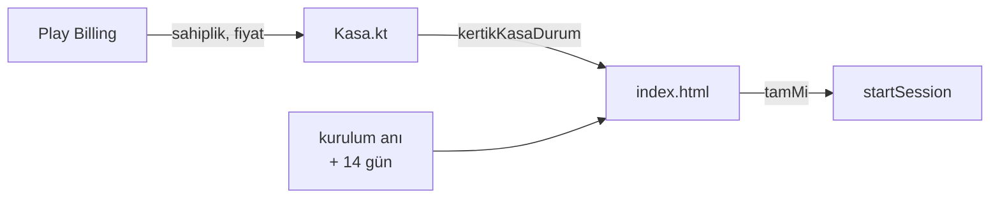

# 37 — Kertik Tam: kodun durumu (4 Eylül 2026)

`Fiyat.md`'deki karar koda geçirildi. Bu dosya ne yazıldığını, nerede durduğunu ve
neyin eksik kaldığını anlatır. Model tartışması orada, burada yalnız uygulaması var.

Aynı gün içinde model bir kez değişti. İlk yazılan freemium sürümü (dört yüzey
kilitli, çekirdek sonsuza kadar ücretsiz) geri alındı; yerine **deneme, sonra duvar**
kondu. Aşağısı ikinci hâlin kaydıdır.

## Ne değişti

| Dosya | Değişiklik |
| --- | --- |
| `kertik-android/app/build.gradle.kts` | `com.android.billingclient:billing:9.1.0`; sürüm 30 → 31, adı 1.0.2 → 1.1.0 |
| `.../java/com/yusufgunay/kertik/Kasa.kt` | **Yeni.** Satın alma yöneticisi ve sayfa köprüsü |
| `.../java/com/yusufgunay/kertik/MainActivity.kt` | Dört noktada dokunuldu: alan, köprü kaydı, `onResume`, `onDestroy` |
| `.../assets/index.html` | Deneme sayacı, duvar, satın alma yüzeyi, 20 anahtar × 15 dil |
| `simulasyon/simulator.html` | Yeniden üretildi |

Play Billing 8 ve üstü artık zorunlu: 31 Ağustos 2026'dan sonra Play, 7 ve altını
kullanan yeni sürümleri kabul etmiyor. Kütüphane `com.android.vending.BILLING`
iznini kendi manifestinde taşıyor, `AndroidManifest.xml` değişmedi.

## Duvar tam olarak nerede

Tek bir yerde: `startSession()`'ın ilk satırı.

```js
if (!tamMi()) { kasaAc(); return; }
```

Kapı bilerek dar tutuldu. Görevler, kayıt, duvar, seans resimleri, yedek, senkron,
tema ve diller duvardan sonra da çalışıyor. Kilitlenen alet, kayıt değil. Süren bir
seans varsa bitene kadar dokunulmuyor; kimsenin işi ortasından kesilmiyor.

Dar kapının ikinci faydası: kilitlenecek yüzey listesi olmadığı için widget'ın,
bildirimin ve Rahatsız Etmeyin'in "kilitli hâli nasıl görünmeli" sorusu ortadan
kalktı. Freemium sürümünde açık kalan tek iş buydu, artık yok.

## Nasıl çalışıyor



`tamMi()` üç şeye bakar: satın alma var mı, deneme sürüyor mü, köprü var mı.
**Köprü yoksa her şey açık sayılır.** Bir arıza kullanıcının aleyhine sonuçlanmaz;
tarayıcıda ve simülatörde de kilit anlamsız olduğu için orada da açık.

Sahiplik `SharedPreferences`'ta bir gölge olarak duruyor, uçak modunda açılışta
ekran doğru görünsün diye. Doğruluğun kaynağı mağaza: `onResume`'da her seferinde
soruluyor, yanıt OK ise liste yetkili sayılıyor, yani **iade edilen bir satın alma
sahipliği geri alıyor**. Yanıt OK değilse (çevrimdışı) gölgeye dokunulmuyor.

Deneme başlangıcı `localStorage`'ta ayrı bir anahtarda (`kertik.kurulum`), `S`'in
içinde değil: yedek ve bulut senkronu onu taşımıyor. Eski bir kullanıcı güncelleme
sonrası tam on dört gün görüyor, geçmişi yüzünden denemesi bitmiş sayılmıyor.

## Yüzey

Tek ekran. Duvara çarpılınca da, ayarlardan merakla açılınca da aynı; yalnız başlığı
ve çıkışı değişiyor.

Görseli bir kertik çubuğu: dört kesilmiş çentik, beşincisi kesik çizgi. Satın alma o
beşinci çentiği atıyor ve teşekkür ekranında dolu görünüyor.

Altında özellik listesi değil, **kullanıcının kendi kaydı** duruyor: "23 seans ·
18s 55dk", altında "bu kayıt sende kalıyor". Hiç kaydı olmayan kullanıcıda "henüz
kayıt yok" yazıyor. Rakamlar kayıttan hesaplanıyor, ayrıca hiçbir yerde saklanmıyor.

Çıkış gerçek: "geçmişime bakayım" ekranı kapatıyor ve kullanıcı kaydını serbestçe
geziyor. Açılışta duvara çarpılmışsa ekran her açılışta bir kez çıkıyor, çünkü
uygulamanın gerçek durumu bu; kapalı bir kapıyı gizlemek dürüst olmazdı.

## Geliştirme kolaylığı

`localStorage.setItem("kertik.tamProva", "kilit")` — duvarı zorlar.
`"tam"` her şeyi açar. Anahtarı silmek normal davranışa döner.

## Fiyat kodu ilgilendirmiyor

9,99 $ küresel, 149,99 TL Türkiye (`Fiyat.md` bölüm 4). Uygulama fiyatı hiçbir yerde
sabit tutmuyor: `Kasa.kt` biçimlenmiş fiyatı mağazadan okuyup sayfaya veriyor
(`oneTimePurchaseOfferDetailsList[0].formattedPrice`), sayfa da onu olduğu gibi
basıyor. Para birimi, ayraç ve sıra ülkeye göre değiştiği için biçimlendirme
bilerek Play'e bırakıldı. Fiyat Play Console'dan değişince uygulama kendiliğinden
uyuyor, yeni sürüm gerekmiyor.

## Açık kalan

**Künyedeki sürüm yazısı.** `ha_versiyon` sözlükte "Sürüm 1.0 (Build 1)" olarak
sabit; `BuildConfig` ile bağlı değil. 1.0.2'de de yanlıştı, 1.1.0'da daha görünür.

**Kapalı testteki arkadaşlar.** Uygulamayı ücretliyken alanlar Play tarafında
`kertik_tam` sahibi sayılmaz. Tanıtım kodu gerekiyor, kodda yapılacak bir şey yok.

## Doğrulama

Sayfa tarafı container'da Playwright ile koşturuldu, gerçek bir kayıt (23 seans,
30 güne yayılmış) tohumlanarak:

| Senaryo | Sonuç |
| --- | --- |
| Duvar, açılışta kendiliğinden | Başlık ve kendi kayıt özeti doğru |
| `startSession()` duvarda | Seans açılmıyor, duvar geri geliyor |
| "geçmişime bakayım" | Kapanıyor, kayıt sekmesi geziliyor |
| Satın alma | Teşekkür ekranı, ardından seans açılıyor |
| Deneme sürerken (3 gün kalmış) | Duvar yok, seans açılıyor, DND anahtarı yerinde |
| Ayarlardan açılan yüzey | Duvar başlığı yerine ürün başlığı, çıkış düğmesi yok |
| Koyu tema, İngilizce | Doğru |
| Hiç kaydı olmayan kullanıcı | "henüz kayıt yok" |

Bu testlerin hepsi **sahte bir köprüyle** koşturuldu: `window.KertikKasa` yerine
sabit yanıt veren bir taklit kondu. Yani doğrulanan şey sayfanın mantığı, mağazayla
konuşma değil.

JS hatası yok. Mevcut test paketi (`node test/hepsi.js`) değişiklik öncesi ve sonrası
**birebir aynı sonucu** veriyor: kalan on dosya değişiklikten önce de kırmızıydı.
`test-dil.js` yeni 20 anahtarın hiçbirini ölü ya da eksik olarak işaretlemedi.

### Kotlin tarafı: derlenmedi, imzalar tek tek doğrulandı

Bu ortamda Android SDK yok ve kullanıcının makinesinde kabuk çalıştırılamıyor, yani
`Kasa.kt` hiç derlenmedi ve **gerçek satın alma hiç denenmedi**. Derleme riskinin
tamamı yanlış API adında olduğu için her çağrı resmî referanstan tek tek okundu:

| Çağrı | Durum |
| --- | --- |
| `BillingClient.Builder.enableAutoServiceReconnection()` | var |
| `enablePendingPurchases(PendingPurchasesParams)` | var |
| `ProductDetailsResponseListener` ikinci parametresi | `QueryProductDetailsResult`, liste değil |
| `QueryProductDetailsResult.getProductDetailsList()` | var |
| `OneTimePurchaseOfferDetails.getFormattedPrice()` / `getOfferToken()` | ikisi de var |
| `PurchasesUpdatedListener` ikinci parametresi | `@Nullable List<Purchase>` |

Bu okuma iki gerçek hata çıkardı ve ikisi de düzeltildi:

**1. Fiyat hiç okunamayacaktı.** `getOneTimePurchaseOfferDetailsList()` yalnız
çoklu satın alma seçeneği tanımlanmış ürünlerde doluyor; `kertik_tam` gibi sade bir
üründe **null** dönüyor ve teklif tekil `getOneTimePurchaseOfferDetails()` alanında
duruyor. Kod yalnız listeye bakıyordu, yani satın alma düğmesi rakamsız kalacaktı.
Artık `teklif()` yardımcısı önce listeye, sonra tekil alana bakıyor.

**2. Derleme kırılabilirdi.** `queryPurchasesAsync` geri çağrısındaki liste doğrudan
dolaşılıyordu. İmzanın null verip vermediği referansta gösterilmiyor; `orEmpty()` ile
her iki imzada da derlenir hâle getirildi.

Yine de bu bir derleme değil, bir okuma. İlk `assembleDebug` Android Studio'da
koşturulmalı.

### Gerçek satın alma nasıl test edilir

Buradan test edilemez, çünkü Play Billing sahte bir mağazayla konuşmuyor: imzalı bir
sürüm, Play Console'a yüklenmiş bir paket ve gerçek bir cihaz gerekiyor. Sıra:

1. Android Studio'da derle, `Kasa.kt` ve `MainActivity.kt` hatasız geçsin.
2. Play Console'da uygulamayı ücretsize çevir ve `kertik_tam` ürününü **etkin** yap.
   Ürün etkin değilse `queryProductDetailsAsync` boş döner, fiyat görünmez.
3. İmzalı bir sürümü **iç test** (internal testing) kanalına yükle. Yan yükleme
   (sideload) ile satın alma çalışmaz, paketin Play'den gelmesi şart.
4. Play Console → Ayarlar → Lisans testi listesine Google hesabını ekle. Bu liste
   yalnız uygulama içi satın almayı bedava yapar.
5. Cihazda `localStorage.kertik.kurulum` değerini geçmişe çekerek duvarı tetikle
   (ya da `kertik.tamProva = "kilit"`), satın almayı dene.

Test edilecek dört şey: fiyat doğru para biriminde görünüyor mu, satın alma sonrası
duvar kalkıyor mu, uygulamayı silip kurunca "daha önce aldım" sahipliği geri
getiriyor mu, uçak modunda açılışta sahiplik korunuyor mu.
